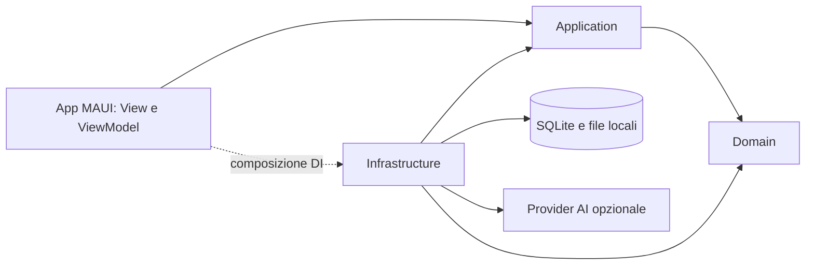
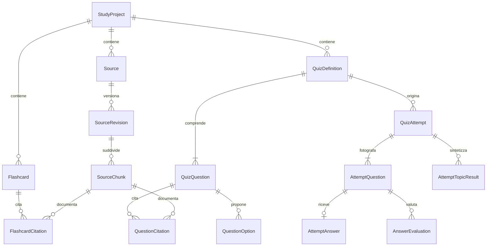

# Architettura dell'applicazione per lo studio universitario

Documento di progetto — fase 0 — 24 ottobre 2026.

Nome tecnico provvisorio della solution: `StudySpace`. Questo documento definisce l'MVP; non costituisce un'implementazione né una verifica di compilazione.

## 1. Decisioni principali e perimetro

Applicazione C# e XAML con .NET MAUI, MVVM e CommunityToolkit.Mvvm, destinata inizialmente a Windows e Android. Ogni progetto universitario è un contenitore indipendente di materiale, flashcard, quiz e risultati. SQLite e i file privati dell'applicazione sono la fonte primaria dei dati; nessun account o server è necessario per usare le funzioni locali.

L'MVP comprende:

- Gestione progetti: nome, descrizione, colore/icona, tag, preferito e date.
- Importazione PDF testuali, TXT, Markdown, DOCX e testo manuale; estrazione, suddivisione in chunk e consultazione della provenienza.
- Flashcard manuali e generate, modifica, eliminazione, preferiti, tag e modalità studio fronte/retro.
- Generazione di quiz chiusi, aperti e misti, configurazione di quantità e difficoltà, verifica per domanda e finale.
- Navigazione libera fra le domande, recupero del tentativo interrotto, risultati, storico e argomenti da migliorare.
- Impostazioni AI e tema Sistema/Chiaro/Scuro, con Sistema predefinito.

Fuori dall'MVP: task manager, calendario, esami, promemoria, notifiche, pianificazione, sincronizzazione, spaced repetition, statistiche avanzate, OCR e modelli AI locali integrati. Si preparano confini di estensione, senza creare servizi vuoti o tabelle speculative per questi moduli.

L'AI remota richiede connessione e configurazione. Local-first non significa che una valutazione semantica remota funzioni offline: lettura, modifica, studio delle flashcard, quiz già salvati, correzione delle risposte chiuse e storico restano locali; generazione e correzione delle risposte aperte possono rimanere in attesa.

## 2. Ambiente verificato e baseline tecnica

La cartella `C:\Users\Antonella\Documents\app-studio` risultava vuota all'inizio dell'analisi. Non sono stati trovati solution, `global.json`, istruzioni `AGENTS.md` applicabili o repository Git inizializzato. Il documento viene creato qui come radice del futuro repository, senza inizializzare Git o installare componenti.

Verifiche locali:

| Elemento | Evidenza / decisione |
| --- | --- |
| SDK installati | 8.0.421, 9.0.304, 10.0.300, 10.0.302 |
| SDK selezionato | 10.0.302, rilevato da `dotnet --info` |
| Runtime .NET 10 | 10.0.8 e 10.0.10 presenti |
| Workload MAUI | `dotnet workload list` fallisce per accesso negato al Service Control Manager; installazione non confermata |
| Pack nel percorso standard | Nessun pack MAUI/Android rilevato in `C:\Program Files\dotnet\packs` |
| Android SDK, JDK, emulatore, IDE e Windows SDK | Compatibilità non ancora verificata |

**Baseline scelta: .NET 10 stabile e .NET MAUI 10**, coerente con l'SDK disponibile. La politica ufficiale consultata indica MAUI 10 come versione supportata; il ciclo di supporto MAUI è distinto da quello del runtime .NET. [Politica di supporto MAUI](https://dotnet.microsoft.com/en-us/platform/support/policy/maui).

Nella fase di scaffolding usare `net10.0` per le librerie e i test, `net10.0-android` e `net10.0-windows10.0.19041.0` per l'app. Il numero nel TFM Windows identifica il target SDK, non da solo il minimo sistema operativo supportato. Scelta di prodotto iniziale: Windows 10 1809 o successivo e Android 10/API 29 o successivo; quest'ultimo minimo semplifica il supporto coerente del tema di sistema. Verificare anche i requisiti delle dipendenze e dei dispositivi reali. [Piattaforme MAUI](https://learn.microsoft.com/en-us/dotnet/maui/supported-platforms?view=net-maui-10.0), [tema di sistema](https://learn.microsoft.com/en-us/dotnet/maui/user-interface/system-theme-changes).

Prima di creare l'app: verificare/installare i workload compatibili, verificare JDK/Android SDK e Windows SDK, compilare una schermata minima su entrambi i target. Quindi fissare SDK 10.0.302 in `global.json` con `allowPrerelease: false` e roll-forward limitato alle patch; registrare la versione effettiva del workload e bloccare le dipendenze NuGet stabili. Nessuna versione di pacchetto viene inventata in questa fase. L'assenza di una build oggi è un prerequisito aperto, non una prova di incompatibilità dell'architettura.

## 3. Solution, dipendenze e cartelle

Quattro progetti di produzione e due di test sono sufficienti. Separazione per responsabilità, senza microservizi, bus di messaggi, MediatR, event sourcing o framework di plugin.

```text
StudySpace.sln
ARCHITECTURE.md
src/
  StudySpace.Domain/
    Projects/ Sources/ Flashcards/ Quizzes/ Learning/
    Common/                     # ID, enum e regole condivise strettamente necessarie
  StudySpace.Application/
    Projects/ Sources/ Flashcards/ Quizzes/ Insights/
    Abstractions/               # porte storage, file e AI
    Contracts/                  # richieste e risultati indipendenti dai provider
    Validation/
  StudySpace.Infrastructure/
    Persistence/               # SQLite, mapping, repository e migrazioni SQL
    Files/                     # copie private, hash, pulizia file
    Import/                    # estrattori per formato e chunking
    Ai/                        # adapter, serializzazione e validazione risposte
    DependencyInjection/
  StudySpace.App/
    Features/
      Projects/ Sources/ Flashcards/ Quizzes/ Results/ History/ Settings/
                                 # Page e ViewModel vicini per funzionalità
    Navigation/ Controls/ Converters/
    Resources/Styles/ Resources/Images/
    Services/                  # adapter MAUI per picker, tema e credenziali
    Platforms/Android/ Platforms/Windows/
    App.xaml AppShell.xaml MauiProgram.cs
tests/
  StudySpace.UnitTests/
  StudySpace.IntegrationTests/
```



- **Domain**: entità e regole pure, nessuna dipendenza MAUI, SQLite, HTTP o Toolkit.
- **Application**: casi d'uso, autorizzazione del contesto progetto, validazioni, orchestrazione e contratti. Non conosce pagine né API del provider.
- **Infrastructure**: implementazioni delle porte, query SQL, parser, HTTP e mapping dei dati esterni.
- **App**: presentazione e adattamento alle piattaforme. I ViewModel chiamano Application; non eseguono SQL, parsing o richieste AI. Il code-behind gestisce soltanto comportamento visuale e ciclo di vita della pagina.

CommunityToolkit.Mvvm vive in App: `ObservableObject`, proprietà generate e `AsyncRelayCommand`, comandi non concorrenti per operazioni mutanti, stato busy/error e cancellazione. Preferire binding compilati con `x:DataType`. Non serve una seconda astrazione generica di MVVM.

`MauiProgram` è la composition root. Repository, coordinatore del database e servizi senza stato sono singleton; pagine e ViewModel sono transient. Un tentativo attivo viene ricaricato per ID: niente ViewModel singleton né progetto corrente globale mutabile. I singleton non trattengono pagine. Client HTTP riutilizzati tramite factory; eventuali credenziali vengono lette al momento della richiesta. Tutti i servizi necessari ricevono dipendenze tramite costruttore.

## 4. Modello del dominio

Gli ID sono GUID generati localmente; le date persistite sono UTC, convertite nel fuso locale solo in presentazione. I nomi delle entità sono in inglese; UI e documento sono in italiano. Le entità modificabili hanno `CreatedAtUtc`, `UpdatedAtUtc` e un contatore `Revision` per rilevare aggiornamenti obsoleti.

| Entità | Proprietà principali e responsabilità |
| --- | --- |
| StudyProject | Id, Name, Description, Color, IconKey, IsFavorite, date. Radice di isolamento dei contenuti |
| Tag | Id, ProjectId, Name, NormalizedName; vocabolario del singolo progetto |
| Source | Id, ProjectId, Title, Kind, OriginalFileName, IsArchived, CurrentRevisionId, date |
| SourceRevision | Id, ProjectId, SourceId, Number, ContentHash, RelativeFilePath opzionale, ExtractedText, ExtractionStatus, ErrorCode, ExtractorVersion, CreatedAtUtc |
| SourceChunk | Id, ProjectId, SourceRevisionId, Ordinal, Text, StartOffset, EndOffset, PageStart/PageEnd opzionali, SectionPath opzionale, ChunkerVersion |
| Flashcard | Id, ProjectId, Front, Back, Explanation opzionale, Difficulty opzionale, IsFavorite, Origin manuale/AI, GenerationRunId opzionale, date |
| Topic | Id, ProjectId, Name, NormalizedName; argomento didattico usato per rubriche e statistiche |
| QuizDefinition | Id, ProjectId, Title, Mode, RequestedCount, Difficulty, GenerationRunId, CreatedAtUtc, IsArchived; configurazione e domande riutilizzabili |
| QuizQuestion | Id, ProjectId, QuizDefinitionId, Position, Kind, Prompt, Explanation, IdealAnswer, RubricJson, Difficulty |
| QuestionOption | Id, ProjectId, QuestionId, Position, Text, IsCorrect |
| QuizAttempt | Id, ProjectId, QuizDefinitionId opzionale, Mode, Difficulty, Status, StartedAtUtc, SubmittedAtUtc, CompletedAtUtc, ActiveDurationMs, Score, MaximumScore, ScoringVersion |
| AttemptQuestion | Id, ProjectId, AttemptId, Position, OriginalQuestionId opzionale, SnapshotJson, SnapshotSchemaVersion; copia immutabile della domanda |
| AttemptAnswer | AttemptQuestionId, ProjectId, Text oppure SelectedOptionId, AnswerRevision, AnsweredAtUtc, EvaluationStatus |
| AnswerEvaluation | Id, ProjectId, AttemptQuestionId, AnswerRevision, Outcome, Score, CorrectConceptsJson, MissingConceptsJson, ErrorsJson, Explanation, Hint, IdealAnswer, EvaluatedAtUtc, EvaluatorMetadataJson |
| AttemptTopicResult | AttemptId, ProjectId, TopicId, EarnedScore, MaximumScore, EvidenceCount, DetailsJson; evidenze e suggerimenti cristallizzati alla chiusura |
| GenerationRun | Id, ProjectId, Operation, ProviderKey, ModelName, PromptVersion, InputChunkIdsJson, CreatedAtUtc; tracciabilità essenziale, senza segreti |

La rubrica di una risposta aperta contiene criteri con ID, TopicId, concetto atteso, peso e riferimenti ai chunk. I pesi sommano a 1. L'AI restituisce il grado di soddisfacimento di ciascun criterio; Application calcola il punteggio. La rubrica viene salvata prima che l'utente risponda e non cambia in base alla risposta.

`SourceCitation` è un valore composto da identificatori di fonte/revisione/chunk, estratto, titolo e localizzatore. Flashcard e domande possono citare più chunk: la provenienza non è un unico campo stringa. Per contenuti manuali la citazione è facoltativa. Un contenuto AI privo di evidenze verificabili non viene accettato come materiale fondato sulle fonti.

Tag e Topic hanno scopi diversi: il tag è un'etichetta organizzativa libera; il Topic è una chiave stabile per aggregare difficoltà. Nel MVP si riusa un argomento esistente per nome normalizzato, ma non si uniscono automaticamente sinonimi sulla base di supposizioni AI.

## 5. Schema SQLite e integrità

Database unico `studyspace.db3` nella directory privata dati dell'app, file originali separati sotto `sources/{projectId}/{sourceId}/{revisionId}/`. In SQLite si salvano percorsi relativi, mai percorsi originali del computer o URI Android come riferimenti permanenti.

Scelta iniziale: **sqlite-net-pcl**, con mapping confinato in Infrastructure e SQL esplicito per migrazioni, foreign key e query aggregate. È un approccio documentato per MAUI; Microsoft.Data.Sqlite resta un'alternativa, ma non verranno mantenuti due provider. [Database locali MAUI](https://learn.microsoft.com/en-us/dotnet/maui/data-cloud/database-sqlite?view=net-maui-10.0).

Le tabelle corrispondono alle entità sopra. Tabelle associative con chiave primaria composta:

| Tabella | Relazione |
| --- | --- |
| ProjectTag(ProjectId, TagId) | Tag applicati al progetto stesso |
| SourceTag(ProjectId, SourceId, TagId) | Fonti ↔ tag |
| FlashcardTag(ProjectId, FlashcardId, TagId) | Flashcard ↔ tag |
| QuestionTopic(ProjectId, QuestionId, TopicId, Weight) | Domande ↔ argomenti |
| FlashcardCitation(ProjectId, FlashcardId, ChunkId) | Flashcard ↔ chunk |
| QuestionCitation(ProjectId, QuestionId, ChunkId) | Domande ↔ chunk |
| AttemptQuestionTopic(ProjectId, AttemptQuestionId, TopicId, Weight, TopicNameSnapshot) | Argomenti storici interrogabili senza leggere JSON |
| AttemptCitation(ProjectId, AttemptQuestionId, ChunkId, QuoteSnapshot, LocatorSnapshot, SourceTitleSnapshot) | Provenienza del tentativo |



Il diagramma riassume le relazioni principali; tabelle associative e vincoli indicati nel testo completano lo schema.

Regole obbligatorie:

1. `PRAGMA foreign_keys = ON` su ogni connessione, verificato con test. Le migrazioni creano esplicitamente i vincoli: gli attributi del mapping non bastano.
2. Ogni tabella di contenuto porta `ProjectId`. I parent espongono `UNIQUE(ProjectId, Id)` e le relazioni usano foreign key composite per impedire legami fra progetti differenti, anche nelle associazioni. Le query ricevono sempre ProjectId e non soltanto l'ID figlio.
3. Unicità per `(ProjectId, NormalizedName)` di tag e argomenti, `(SourceId, Number)`, `(SourceRevisionId, Ordinal)`, `(QuizDefinitionId, Position)`, `(AttemptId, Position)` e `(AttemptQuestionId, AnswerRevision)` delle valutazioni accettate. Ogni domanda chiusa ha almeno due opzioni e una sola corretta: il servizio valida questo vincolo prima del salvataggio atomico.
4. Score di domanda fra 0 e 1, durate non negative, stringhe obbligatorie non vuote. Le opzioni selezionate devono appartenere allo snapshot della domanda. Enum come valori stabili, senza dipendenza dall'ordine della dichiarazione C#.
5. Indici per `(ProjectId, UpdatedAtUtc)` sui contenuti, `(ProjectId, StartedAtUtc)` sui tentativi, chiavi esterne e stato dei lavori recuperabili. Paginazione di fonti, card e storico; niente caricamento dell'intero progetto nel ViewModel.
6. JSON soltanto per strutture variabili o snapshot: rubriche, feedback e metadati versionati. ID, relazioni, punteggi, date e campi usati per filtrare/aggregare restano colonne.
7. Un solo coordinatore di scrittura, transazioni brevi, timeout per database occupato e WAL se validato sui target. Nessuna transazione aperta durante parsing o HTTP. Non simulare asincronia sul thread UI: l'accesso SQLite viene accodato fuori dal thread grafico.

Migrazioni SQL numerate e tabella `SchemaMigration(Version, AppliedAtUtc)`. Applicare ogni migrazione in transazione quando compatibile con le operazioni usate; prima di aggiornamenti distruttivi creare un backup coerente tramite API di backup SQLite oppure dopo chiusura/checkpoint delle connessioni, mai copiando solo il file principale con WAL attivo. Un errore interrompe l'avvio dei servizi dati, preserva l'archivio e mostra un messaggio recuperabile: non ricreare silenziosamente il database.

### Conservazione ed eliminazione

- Modificare una fonte produce una nuova revisione e nuovi chunk. I riferimenti precedenti restano validi; `CurrentRevisionId` deve puntare a una revisione della stessa fonte e progetto.
- Eliminare una fonte dalla UI la archivia e la esclude dalle nuove generazioni. Revisioni e chunk già citati rimangono disponibili; questa conservazione va spiegata nell'interfaccia.
- Eliminare una flashcard rimuove card e associazioni. Archiviare un quiz lo toglie dalle nuove sessioni, lasciando i tentativi.
- All'avvio di un tentativo si copiano testo, ordine delle opzioni, soluzione, spiegazione, rubrica, argomenti e citazioni. Un vecchio tentativo non dipende dalla versione corrente del quiz o del provider.
- Eliminare definitivamente un progetto richiede una conferma esplicita nella futura UI e rimuove tutto il suo archivio, compreso lo storico. Prima commit della cancellazione dati, poi pulizia idempotente dei file; un controllo di orfani riprende la pulizia dopo un crash. Nessuna cancellazione di file fuori dalla directory privata risolta e verificata.

## 6. Servizi e interfacce

Interfacce solo ai confini che richiedono sostituzione o test. I servizi applicativi semplici possono essere classi concrete.

| Contratto / servizio | Responsabilità |
| --- | --- |
| ProjectService + IProjectRepository | CRUD, preferiti, tag e riepilogo progetto |
| SourceImportService + ISourceRepository | Importazione, revisioni, stato e commit di testo/chunk |
| ISourceTextExtractor | `CanHandle(format)`, `ExtractAsync(stream, cancellationToken)` → testo e segmenti con localizzatori |
| ITextChunker | Segmenti → chunk deterministici con offset e provenienza |
| ISourceFileStore | Copia temporanea, promozione nella cartella privata, lettura e pulizia |
| FlashcardService + IFlashcardRepository | CRUD, tag, preferiti, sessione di studio e salvataggio delle bozze AI |
| QuizService + IQuizRepository | Configurazione, validazione e persistenza del quiz generato |
| QuizAttemptService + IAttemptRepository | Snapshot, risposte, verifica, chiusura idempotente e ripresa |
| IAiStudyService | Generazione flashcard, generazione quiz e valutazione semantica |
| IStudyContextBuilder | Scelta dei chunk del progetto entro il budget; nessun accesso trasversale |
| StudyInsightsService + IStudyReadRepository | Punteggi, storico e difficoltà da valutazioni persistite |
| IClock | Date testabili; tempo attivo misurato separatamente con timer monotono |
| INavigationService | Contratto in App per navigazione testabile dei ViewModel |
| IFilePickerService, IThemeService, ICredentialStore | Adapter di piattaforma in App; credenziali esposte all'adapter AI tramite una porta Application |

I repository offrono operazioni per caso d'uso, come `SaveImportedRevisionAsync` o `FinalizeAttemptAsync`, che racchiudono le transazioni necessarie. Non introdurre un repository generico per ogni tabella o esporre connessioni SQL ai servizi applicativi.

Contratto AI concettuale, da tradurre in codice nella fase successiva:

```csharp
public interface IAiStudyService
{
    Task<FlashcardDraftBatch> GenerateFlashcardsAsync(
        FlashcardGenerationRequest request, CancellationToken cancellationToken);
    Task<QuizDraft> GenerateQuizAsync(
        QuizGenerationRequest request, CancellationToken cancellationToken);
    Task<OpenAnswerAssessment> EvaluateOpenAnswerAsync(
        OpenAnswerEvaluationRequest request, CancellationToken cancellationToken);
}
```

Le richieste contengono contesto immutabile, chunk identificati, lingua, limiti e configurazione; la valutazione contiene domanda, rubrica e revisione della risposta. I risultati non contengono tipi di SDK esterni. Gli errori distinguono annullamento, rete, credenziali, quota, formato non valido e materiale insufficiente. Una cancellazione non è mostrata come errore tecnico.

## 7. Importazione e chunking

Flusso: selezione → validazione formato/dimensione → copia privata temporanea e hash → estrazione → normalizzazione con mappa dei localizzatori → chunking → salvataggio della revisione e dei chunk → stato Ready. Per il testo manuale la copia del file è facoltativa, mentre la revisione del testo resta obbligatoria.

Stati di estrazione: Pending, Processing, Ready, Failed, Cancelled. Una fonte compare come pronta soltanto dopo commit completo. Al riavvio, Processing senza operazione attiva torna recuperabile; non viene dichiarato concluso. File già promossi e non referenziati si ripuliscono con controllo di orfani. Il vecchio contenuto Ready resta disponibile durante la rielaborazione.

| Formato | Strategia e limiti |
| --- | --- |
| TXT | UTF-8 predefinito, rilevamento BOM; segnalare decodifica fallita invece di sostituire silenziosamente caratteri |
| Markdown | Conservare originale, estrarre testo con titoli e paragrafi; nessuna esecuzione di HTML/script |
| Testo manuale | Titolo obbligatorio e testo salvato come revisione |
| PDF | Estrattore di testo con pagine; colonne, formule e tabelle possono avere ordine imperfetto; anteprima del testo estratto |
| DOCX | Lettura Open XML di paragrafi e tabelle; citazione per sezione/paragrafo, senza inventare numeri di pagina dipendenti da Word |

Parser candidati: PdfPig per PDF e Open XML SDK per DOCX, da confermare con prova Release Android/Windows, licenze, consumi e supporto al trimming prima di fissarli. Nessuna dipendenza da Word installato. PDF scansionati o protetti producono un messaggio comprensibile e l'alternativa del testo manuale; OCR rinviato.

Limiti iniziali configurabili, da misurare su dispositivo: 25 MB per file, 2 milioni di caratteri estratti, limite esplicito anche alla dimensione decompressa di DOCX. Elaborazione incrementale dove possibile; massimo un'importazione pesante alla volta su telefono. File MIME/estensione incoerenti, contenuti corrotti e archivi eccessivi vengono rifiutati.

Chunking iniziale per paragrafi/sezioni, circa 2.000–4.000 caratteri con sovrapposizione limitata a circa 300, senza presumere che un carattere equivalga a un token. L'adapter AI verifica il budget reale del modello e riduce il contesto. Offset riferiti al testo normalizzato della revisione, intervallo `[StartOffset, EndOffset)`, ordine stabile e pagine/sezioni mantenute. Hash e versione del chunker consentono ripetibilità e deduplicazione nella stessa fonte; nessuna deduplicazione globale che colleghi progetti indipendenti.

## 8. AI indipendente dal provider e fondata sulle fonti

`IAiStudyService` è implementata in Infrastructure. L'app registra un adapter selezionato per configurazione. OpenAI, proxy personale e modello locale sono implementazioni alternative future dello stesso contratto; non si implementano tutti nell'MVP. Test e sviluppo usano un fake deterministico, chiaramente distinto da una vera valutazione semantica.

Pipeline:

1. Application verifica ProjectId e disponibilità di fonti Ready non archiviate.
2. Il context builder seleziona chunk solo da quel progetto. Nel MVP usa copertura bilanciata di fonti/sezioni e semplici filtri; niente vector database o embeddings obbligatori.
3. Per materiale lungo divide la generazione in batch, con budget e deduplicazione delle domande. Non promette copertura dell'intero progetto se ha campionato solo una parte; mostra fonti considerate.
4. Prompt con istruzioni separate dai dati: il contenuto delle fonti e le risposte dello studente sono dati non affidabili, mai istruzioni da eseguire. Nessun tool o accesso esterno concesso al modello.
5. Output strutturato, con schema interno versionato e citazioni obbligatorie per i contenuti generati. Se il provider supporta JSON vincolato si usa, senza rendere questa API un requisito della UI.
6. Validazione locale di tipo, quantità, punteggi, opzioni, rubriche e citazioni: ogni ID deve appartenere al contesto inviato e l'estratto deve corrispondere al testo. La validità dell'ID non dimostra da sola la correttezza semantica: mantenere anteprima e possibilità di modifica/segnalazione.
7. Se le fonti non bastano, restituire materiale insufficiente o proporre meno domande, senza inventare conoscenze esterne. Nell'MVP la politica è esclusivamente basata sulle fonti selezionate.
8. Le bozze validate sono mostrate e salvate localmente; le flashcard restano modificabili. Modifiche manuali invalidano l'eventuale indicazione di validazione AI precedente e richiedono ricontrollo delle citazioni.

Timeout, cancellazione e numero di retry limitato. Retry soltanto per errori transitori, rispettando i limiti del provider; nessun ciclo illimitato per correggere JSON. Una richiesta può essere stata fatturata anche se il client non ha ricevuto risposta. ID operazione e commit idempotente evitano duplicati locali; non si promette deduplicazione del costo remoto.

Mai chiavi in codice, log, database o repository. Per uso personale una chiave inserita dall'utente risiede nel secure storage di piattaforma; per distribuzione di un servizio con chiave del produttore è preferibile un proxy autenticato. Nessun segreto incorporato in APK/MSIX è considerato protetto. L'interfaccia indica quali estratti verranno inviati al servizio remoto e richiede l'abilitazione esplicita dell'utente. I log riportano ID operazione, durata e codice errore, non materiale di studio, risposte o credenziali. Il database locale non è automaticamente cifrato: cifratura integrale e backup utente sono decisioni successive, non funzionalità implicite.

## 9. Quiz: comportamento, stati e calcolo dei risultati

### Configurazione e avvio

Tipo Closed/Open/Mixed, numero 1–50 come limite iniziale di prodotto e difficoltà Easy/Medium/Hard. Mixed richiede almeno due domande e contiene entrambi i tipi; ripartizione iniziale metà e metà, con eventuale domanda in più chiusa. La difficoltà richiesta è un'indicazione didattica, non una misura psicometrica certificata. Le richieste prevedono filtri opzionali per SourceId, TopicId e TagId, ma l'interfaccia avanzata di selezione può essere aggiunta dopo l'MVP.

All'avvio, una transazione crea tentativo e snapshot. Ordine di domande e opzioni viene fissato e salvato; non cambia tornando sulla pagina. Ogni risposta confermata viene persistita prima di mostrarla come acquisita. Per il testo aperto autosalvataggio con debounce e flush su cambio domanda, verifica, uscita e sospensione, con indicatore di salvataggio; la terminazione forzata può perdere l'ultimo testo non ancora salvato.

### Stati distinti

- Tentativo: InProgress → SubmittedPendingEvaluation → Completed; possibile Abandoned da InProgress.
- Risposta: Unanswered oppure Answered, con valutazione separata NotRequested, Pending, Evaluating, Evaluated o Failed.
- Esito valutato: Correct, Partial, Incorrect; Unanswered è una categoria di risultato separata.
- Current è uno stato visuale ortogonale: una domanda può essere corrente e corretta allo stesso tempo.

### Verifica immediata

Per le risposte chiuse, selezionare un'opzione salva e corregge localmente in un'unica operazione. Mostrare subito esito, soluzione ed explanation basata sulle fonti. La scelta è bloccata dopo la verifica, così lo storico registra la prima risposta e non una correzione fatta dopo aver visto la soluzione.

Per le risposte aperte, `Verifica ora` salva prima la risposta e poi avvia la valutazione semantica. Durante la verifica il testo è bloccato; una verifica riuscita blocca la risposta per quel tentativo. In caso di fallimento si può modificare/riprovare; ogni modifica incrementa AnswerRevision. Una risposta remota arrivata in ritardo si applica soltanto se ID e revisione coincidono. Risposte vuote/spazi non chiamano l'AI. Per esercitarsi di nuovo si avvia un altro tentativo.

Ogni valutazione aperta conserva punteggio, concetti corretti, mancanti, errori, spiegazione, suggerimento e risposta ideale. I giudizi sono feedback di studio, con evidenze consultabili; non sono voti accademici certificati. L'assenza di rete non viene trasformata in risposta errata né sostituita da confronto testuale.

### Termine, recupero e idempotenza

`Termina quiz` salva le risposte e rende il tentativo non modificabile. Le domande aperte con risposta e senza valutazione valida vengono valutate; quelle già verificate non richiamano l'AI. Non risposte: zero punti, categoria Unanswered, nessuna chiamata AI.

Se rete o provider falliscono, lo stato rimane SubmittedPendingEvaluation e la schermata mostra risultati provvisori, numero di valutazioni mancanti e azione Riprova. Non si mostra una percentuale finale ingannevole. Al riavvio i lavori Evaluating diventano riprendibili su azione dell'utente, senza dipendere da processi in background Android. Solo quando tutte le risposte pertinenti sono valutate una transazione calcola totale, categorie e difficoltà e marca Completed. Doppio clic e retry della chiusura non duplicano valutazioni o tentativi.

Il tempo impiegato è il tempo attivo di compilazione: timer monotono, accumulo periodico e su sospensione, pausa quando l'app non è attiva e durante la valutazione AI. Il tempo di attesa del provider non penalizza lo studente. Il totale può perdere l'ultimo intervallo non persistito in caso di arresto improvviso; usare checkpoint brevi, ad esempio 5 secondi.

### Punteggi e risultati

Ogni domanda vale massimo 1 punto; chiusa 0 o 1. Aperta: somma dei gradi di soddisfacimento dei criteri moltiplicati per i relativi pesi, normalizzata fra 0 e 1. La politica MVP classifica Correct con score ≥ 0,8, Partial con 0 < score < 0,8, Incorrect con score = 0; gli errori concettuali indicati dalla rubrica possono porre limiti espliciti al punteggio. Conservare `ScoringVersion` e non reinterpretare automaticamente tentativi passati.

`Score = somma dei punteggi`, `MaximumScore = numero totale domande`, `Percentage = 100 × Score / MaximumScore`. Arrotondamento solo in UI. Il conteggio delle corrette può differire dalla percentuale, perché le aperte danno credito parziale. Le quattro categorie corrette/errate/parziali/non risposte sono disgiunte e sommano al numero di domande. Nei risultati provvisori aggiungere la categoria in attesa.

La schermata finale mostra punteggio, percentuale, quattro conteggi, tempo attivo, dettaglio per domanda, risposta data, soluzione, feedback qualitativo e citazioni. Lo storico apre la stessa schermata in sola lettura dai dati salvati, senza ricontattare il provider.

## 10. Argomenti da migliorare e statistiche

Il servizio locale aggrega i criteri della rubrica per TopicId. Per domande chiuse il punteggio si distribuisce sugli argomenti secondo i pesi di QuestionTopic; per le aperte si usano i punteggi dei singoli criteri, evitando di attribuire lo stesso errore a tutti gli argomenti.

Indice di difficoltà del tentativo: `1 - EarnedScore / MaximumScore` per argomento. Mostrare gli argomenti con indice ≥ 0,3, ordinati per indice e quantità di evidenze; soglia iniziale di prodotto, versionata e da rivedere con l'uso. Non risposte indicate separatamente come mancanza di evidenza: non bastano da sole a dichiarare una difficoltà concettuale. Una sola domanda genera una segnalazione con evidenza limitata, non un giudizio stabile.

Ogni voce include concetti mancanti/errori, domande che motivano la segnalazione, fonti/pagine/sezioni da rivedere e un suggerimento concreto, ad esempio rileggere la sezione e ripetere una flashcard pertinente. Si compone il testo dai feedback già salvati: nessuna seconda chiamata AI obbligatoria per ottenere i risultati. Se non esistono citazioni, dichiararlo senza inventare una fonte.

Il riepilogo progetto offre numero di tentativi completati, ultimo risultato e riepilogo degli argomenti critici. Le future curve temporali useranno StartedAtUtc, Mode, Difficulty, TopicId e ScoringVersion; quiz con difficoltà e contenuto diversi non sono automaticamente confrontabili. Le proiezioni aggregate sono ricostruibili, mentre snapshot e valutazioni storiche sono conservati.

## 11. Navigazione, responsive e tema

MAUI Shell con root Progetti e Impostazioni. Dal progetto si entra nelle sezioni Panoramica, Fonti, Flashcard, Quiz e Storico. Su desktop navigazione laterale persistente quando lo spazio lo consente; su telefono barra/tab compatta e pagine di dettaglio a schermo intero. Usare la larghezza disponibile e VisualStateManager, non il solo tipo di dispositivo.

Mappa logica delle rotte, da registrare esplicitamente in Shell:

```text
//projects
//settings
project?projectId=...
sources?projectId=...          source?projectId=...&sourceId=...
flashcards?projectId=...      flashcard-edit?...   flashcard-study?...
quiz-setup?projectId=...
quiz-run?projectId=...&attemptId=...
quiz-results?projectId=...&attemptId=...
history?projectId=...
```

Passare solo ID, non entità o file grandi. Un adapter di pagina con `IQueryAttributable` valida i parametri e avvia il caricamento cancellabile nel ViewModel; evita dipendenze di navigazione nel Domain. Questo approccio evita i limiti di trimming di `QueryPropertyAttribute`. [Navigazione Shell](https://learn.microsoft.com/en-us/dotnet/maui/fundamentals/shell/navigation?view=net-maui-10.0).

La barra domande è una CollectionView orizzontale scorrevole, con selezione diretta e scorrimento automatico al numero corrente. Stato espresso con testo/icona oltre al colore: contorno per corrente, vuoto per non risposta, indicatore per risposta, spunta per verificata e simboli differenti per corretta/parziale/errata. Fornire etichette accessibili come “Domanda 4, risposta parzialmente corretta”. Su desktop anche tastiera e focus visibile; su smartphone target touch comodi, tastiera virtuale che non copre `Verifica ora` e layout provato con caratteri ingranditi.

Il Back durante un tentativo salva e propone di lasciarlo in pausa o abbandonarlo; la sospensione di sistema non attende un dialogo. Uscire dai risultati non riapre automaticamente una sessione già conclusa. Errori di caricamento, progetto eliminato e tentativo inesistente hanno un percorso di ritorno sicuro.

Tema in Preferences, non nel database didattico: System → `AppTheme.Unspecified`, Light → Light, Dark → Dark. Applicare all'avvio prima della prima pagina; risorse centralizzate tramite `AppThemeBinding` e risorse dinamiche. Il cambio di sistema deve aggiornare l'app aperta quando System è selezionato; non basta leggere il tema una volta. Verificare il flag Android UiMode del template. [Tema MAUI](https://learn.microsoft.com/en-us/dotnet/maui/user-interface/system-theme-changes).

## 12. Criticità delle piattaforme

| Area | Rischio e risposta progettuale |
| --- | --- |
| File Android | Il picker può fornire URI/stream, non percorsi fisici; copiare subito in storage privato e non richiedere accesso generale ai file |
| Vita del processo | Android può terminare l'app; stato persistito continuamente e ripresa esplicita, nessuna affidabilità attribuita al solo evento di chiusura |
| Memoria | PDF, DOCX e raccolte grandi richiedono limiti, streaming, paginazione e cancellazione |
| Trimming/Release | Parser, SQLite nativo, reflection e serializer vanno verificati con build Release su dispositivo; preferire metadati JSON generati dove applicabile |
| Windows | Ridimensionamento, DPI, tastiera, back e distribuzione MSIX/firma da provare; MVP a finestra singola per evitare editor concorrenti |
| Android release | Verificare ABI, pacchetti nativi SQLite, firma, target SDK richiesto dal canale di distribuzione e funzionamento su dispositivo reale |
| Credenziali | Secure storage può essere invalidato da reinstallazione/ripristino; chiedere nuova configurazione senza perdere i dati didattici |
| Backup di piattaforma | Politica esplicita prima del rilascio: evitare backup di segreti e ripristini incoerenti tra DB/file; local-first non equivale a backup |
| Rete | Timeout e interruzioni possono avvenire dopo l'invio; mantenere risposte e stato locale, nessuna perdita del tentativo |
| Testo complesso | Formule, tabelle, scansioni e documenti multicolonna richiedono anteprima e segnalazione dei limiti di estrazione |

I requisiti esatti di JDK, Android SDK e Windows App SDK seguono la versione effettiva del workload, da verificare nella fase successiva; non si deducono dalla sola presenza dell'SDK .NET. [Installazione MAUI](https://dotnet.microsoft.com/en-us/learn/maui/first-app-tutorial/install).

## 13. Verifica e criteri di accettazione

Nessun test applicativo viene eseguito nella fase documentale. La futura implementazione deve includere test di comportamento, non soltanto test che riproducono il codice.

- Unit test: isolamento progetto, rubriche e soglie, somma dei conteggi, mixed valido, risposte vuote, valutazione obsoleta scartata, chiusura ripetuta e classificazione delle difficoltà.
- Integrazione SQLite reale su database temporaneo: migrazioni da ogni versione supportata, rollback, foreign key composite, snapshot immutabili, archiviazione fonte, eliminazione progetto e ripresa dopo errore.
- Importazione: fixture TXT/MD/DOCX/PDF con citazioni, file corrotti, scansioni, limiti, annullamento, offset e revisioni precedenti.
- Contratti AI con fake: JSON malformato, citazione fuori progetto, numero domande errato, budget insufficiente, timeout e duplicazione richiesta; verifica reale opzionale senza chiavi nel repository.
- Smoke test Release Windows e Android: importazione, quiz chiuso offline, risposta aperta con errore di rete e ripresa, sospensione, riapertura dello storico, tema cambiato a runtime e font ingranditi.

Criteri osservabili dell'MVP:

1. Materiale del progetto A non compare mai in generazioni, citazioni o risultati del progetto B.
2. Modificare/archiviare una fonte o un quiz non cambia un tentativo completato.
3. “Verifica ora” restituisce feedback per una singola aperta; “Termina” valuta tutte e sole le aperte risposte ancora da valutare.
4. Un errore AI non attribuisce zero automaticamente e il tentativo è recuperabile dopo riavvio.
5. Punteggi e conteggi sono coerenti; ogni difficoltà mostrata rimanda a evidenze salvate.
6. Tutte le domande sono raggiungibili dalla barra anche su schermi piccoli con 50 domande.
7. Senza rete restano disponibili contenuti locali, studio, correzione chiusa e storico.
8. Tema Sistema segue il dispositivo senza perdere selezioni o risposte.

## 14. Sequenza di realizzazione e aperture future

1. **Fondazione**: prerequisiti MAUI verificati, solution, DI, Shell, tema e build minima su entrambi i target.
2. **Dati locali**: migrazioni, progetti, fonti manuali/TXT/Markdown e flashcard manuali; dimostrare persistenza e isolamento.
3. **Importazione completa**: PDF e DOCX, chunking, citazioni e gestione revisioni.
4. **Motore quiz locale**: snapshot, navigazione, correzione chiusa, salvataggio e risultati con dati di test.
5. **AI**: primo adapter scelto, generazione, rubriche, risposte aperte e recupero delle valutazioni fallite.
6. **Completamento MVP**: storico, argomenti critici, accessibilità e prove Release sui due target.

La suddivisione è un ordine di implementazione, non una riduzione dei requisiti dell'MVP. Questa fase termina con il solo documento.

Spaced repetition potrà aggiungere ReviewLog e CardSchedule riferiti a FlashcardId; task/calendario potranno riferirsi a ProjectId senza entrare nei servizi AI. La sincronizzazione richiederà una futura progettazione di identità, versioni, conflitti, tombstone e trasferimento dei file: GUID e date aiutano, ma non la implementano. Non introdurre adesso un motore di sync.

Decisioni da chiudere durante le prove tecniche, senza cambiare i confini dell'architettura: versione esatta dei workload e dei pacchetti, parser validati su Android Release, primo provider/modello con relativo budget, canale di distribuzione e politica di backup. Le funzionalità di studio locali possono essere sviluppate indipendentemente da queste scelte AI.

## 15. Attuazione della fase 1

La fase 1 implementa le fondamenta, senza AI, importazione o motore quiz/flashcard. I quattro progetti di produzione rispettano le dipendenze illustrate; repository e servizio concreti sono presenti solo per i casi d'uso già esposti (creazione e lettura paginata dei progetti). Le altre entità e relazioni sono predisposte nel dominio e nella migrazione iniziale, senza servizi fittizi.

Per seguire i nomi richiesti nella fase 1, Source diventa StudySource, Flashcard diventa FlashCard, QuizDefinition diventa Quiz, AttemptAnswer diventa QuizAnswer e AttemptTopicResult diventa StudyWeakness. ProjectTag resta l'associazione a chiave composta verso Tag. SourceRevision e AttemptQuestion preservano rispettivamente la provenienza versionata e il confine degli snapshot; i servizi che li popoleranno saranno implementati nelle fasi successive. OriginalQuestionId e SelectedOptionId del tentativo sono riferimenti storici da interpretare nello snapshot, non dipendenze dal quiz corrente.

Lo schema iniziale non anticipa le tabelle AI, le valutazioni qualitative e tutte le associazioni degli argomenti del motore quiz: verranno introdotte tramite nuove migrazioni insieme alle relative funzionalità. Nessuna migrazione già distribuita dovrà essere riscritta.

La navigazione iniziale comprende Progetti, Preferiti, Statistiche e Impostazioni, come richiesto nella fase 1. Shell usa un menu compatto e un pannello bloccato oltre 1000 unità di larghezza. I due moduli non ancora disponibili sono placeholder. La pagina di creazione rende funzionante il pulsante della home.

SQLite usa sqlite-net-pcl 1.11.285, foreign key esplicite e una connessione per operazione serializzata; WAL è rinviato. I DTO di mapping sono separati dal dominio e preservati dal trimming. Errori di storage non cancellano il database. Il tema è configurato dopo il caricamento delle risorse globali, prima della creazione della finestra; Shell viene risolta dalla DI solo dopo l'inizializzazione delle risorse.

SDK 10.0.302 e workload set 10.0.303.1 sono fissati in global.json; workload MAUI 10.0.20 installato per Windows e Android. Le versioni realmente installate sostituiscono l'incertezza della ricognizione iniziale. README contiene requisiti, comandi di compilazione, test e limiti della verifica.

## 16. Attuazione della fase 2: progetti

La gestione progetti estende i quattro livelli esistenti senza modificarne le dipendenze. ProjectService valida i draft e coordina creazione, lettura, modifica, preferiti ed eliminazione; IProjectRepository espone ricerca paginata, tag e riepiloghi. Il dominio non dipende da SQLite o MAUI. I mapping ProjectRow e TagRow rimangono nell'infrastruttura e sono preservati dal trimming.

I tag restano entità isolate per progetto collegate da ProjectTag. Il draft accetta fino a dieci etichette normalizzate e deduplicate; il repository aggiorna progetto e associazioni nella stessa transazione. Modifica, preferito e cancellazione usano Revision per impedire la sovrascrittura silenziosa di dati cambiati. La cancellazione confermata elimina il grafo SQLite del solo progetto tramite foreign key; la futura importazione dovrà integrare il ciclo di vita dei file esterni.

La migrazione 002 aggiunge SearchText e indici per i filtri e popola SearchText per i progetti preesistenti. La migrazione 001 non cambia. Ricerca parametrizzata su nome e descrizione, senza distinzione di maiuscole e accenti, combinata con filtri per tag e preferiti; ordinamento stabile per ultima modifica e ID. Le associazioni delle card vengono lette in blocco per pagina. I conteggi dashboard distinguono fonti attive, flashcard e tentativi quiz completati, sempre vincolati a ProjectId.

ProjectsViewModel serve Home e Preferiti; CreateProjectViewModel serve creazione e modifica, mantenendo il draft in caso di errore. ProjectActions centralizza menu e conferma attraverso IProjectDialogs, implementato nell'app MAUI. ShellNavigationService gestisce route e parametri; i ViewModel verificano gli ID ricevuti. Il code-behind contiene solo inoltro dei parametri, ciclo di vita e adattamento visivo delle colonne. ProjectCardView e gli stili di tema sono riutilizzati nelle due liste.

La dashboard offre Fonti, Flashcard, Quiz, Storico e Statistiche come pagine placeholder riferite al progetto. Questa fase non implementa servizi AI, importazione o motori di studio. Il README documenta build Debug/Release Windows e Android, 39 test di comportamento superati e i limiti delle verifiche interattive su dispositivo.

## 17. Attuazione della fase 3: fonti e chunk

SourceImportService in Application implementa ISourceImporter e orchestra repository, file privati, IDocumentTextExtractor e ISourceChunkingService. SourceService gestisce lettura paginata, dettagli, rinomina e archiviazione. Nessun ViewModel conosce PdfPig, ZIP, XML, SQL o percorsi originali di piattaforma. I nomi concreti delle porte sostituiscono i candidati ISourceTextExtractor/ITextChunker della sezione 6.

Scelta dei parser confermata: PdfPig 0.1.16 (Apache-2.0, gestito, nessuna dipendenza transitive NuGet sui target usati) per PDF; librerie ZIP/XML di .NET (MIT) per il solo testo DOCX del corpo. L'Open XML SDK candidato non è necessario per questa lettura e non viene aggiunto. Licenze e avvisi della versione fissata sono distribuiti come MauiAsset. Il supporto di compilazione/trimming/AOT e i test effettivamente eseguiti sono documentati nel README, distinti dalle prove interattive.

La migrazione 003 aggiunge SizeBytes/ErrorMessage a SourceRevision e indici per elenco/stato; le migrazioni precedenti rimangono intatte. SourceId dei chunk viene ricostruito tramite la revisione, mantenendo un'unica relazione autoritativa nel database. Ogni query sui contenuti riceve ProjectId. Ready viene committato atomicamente con testo e chunk; un fallimento non lascia chunk parziali. Le revisioni Ready restano immutabili; la rielaborazione esposta ora riguarda solo errori o interruzioni, senza modificare contenuti già pronti.

SourceStartup avvia il recupero e la pulizia orfani senza bloccare la finestra; la pagina Fonti riprova l'inizializzazione se l'archivio era indisponibile. Un semaforo del servizio serializza le importazioni. I file sono copiati con limite incrementale, SHA-256, nome generato e promozione da .part; il percorso relativo viene persistito prima del parsing. Un riavvio trasforma Pending/Processing in errore recuperabile. Riprova controlla l'integrità della copia; una copia mancante o cambiata richiede una nuova importazione. La cancellazione del progetto committa SQLite prima della pulizia idempotente dei file; i collegamenti simbolici/reparse point non vengono seguiti.

Il controllo dei percorsi è confinato alla radice sources e ai suoi discendenti: la directory dati restituita dalla piattaforma è il confine fidato, mentre alias/mount gestiti da Android nei suoi antenati non vengono reinterpretati come percorsi delle fonti. Warning/error Android usano il tag StudySpace con fase e tipo dell'errore, senza testo dei documenti, percorsi personali o eccezioni grezze.

Il chunker deterministico paragraph-v1 applica i criteri della sezione 7: testo normalizzato, confini naturali quando disponibili, massimo 4.000 caratteri, obiettivo 3.000 e overlap massimo 250. Conserva offset, ordine, provenienza e versione senza vector database. I dettagli mostrano anteprima paginata e 20 chunk per volta per contenere il carico UI. La cancellazione della fonte dalla UI è un'archiviazione spiegata nella conferma; le citazioni rimangono valide. Embedding, ricerca semantica, OCR e generazione AI restano estensioni successive.

## 18. Attuazione della fase 4: flashcard e provider dimostrativo

FlashcardService in Application gestisce CRUD, preferiti, validazione, tag e riferimenti; IFlashcardRepository isola SQLite. IStudyContextRepository legge soltanto materiale del progetto richiesto, con elenco fonti e chunk paginati. Le query di studio caricano gli ID dell'insieme filtrato e il contenuto di una scheda alla volta. ViewModel e comandi gestiscono sessione, risposta inizialmente nascosta, navigazione e mescolamento; il code-behind inoltra parametri e ciclo di vita. Nessun algoritmo di spaced repetition o storico viene introdotto.

FlashcardGenerationService riceve progetto, chunk selezionati, numero e difficoltà e chiama IAiStudyService. Il provider concreto MockAiStudyService in Infrastructure è deterministico, estrae citazioni letterali e dichiara esplicitamente la natura dimostrativa. Non accede alla rete o a credenziali. Un futuro adapter reale sostituirà la registrazione DI senza portare tipi di SDK in Application, dominio o UI. Il limite attuale di 40.000 caratteri richiederà un controllo del budget in token nel futuro adapter.

La generazione verifica da 1 a 30 schede, massimo 20 chunk correnti di fonti pronte e attive, isolamento per progetto e corrispondenza letterale delle citazioni. Le proposte rimangono in memoria fino alla conferma. L'utente può modificarne i contenuti, selezionarle o rimuoverle; i riferimenti originali non vengono riscritti dall'editor dell'anteprima. La transazione finale ricontrolla disponibilità e provenienza. Un identificatore di generazione e un'impronta della selezione rendono idempotente la stessa conferma; una conferma diversa dello stesso lotto viene segnalata come conflitto.

La migrazione 004 aggiunge SearchText e Quote e le tabelle FlashcardDetails, GenerationRun e GenerationInputChunk, senza ricostruire o cancellare le tabelle esistenti. I riferimenti compositi con ProjectId impediscono associazioni fra progetti; la migrazione conserva tag e citazioni precedenti e popola il testo di ricerca. FlashcardDetails conserva SourceId facoltativo, generazione e indicazione di modifica. Le citazioni multiple mantengono chunk, revisione, fonte e localizzatore; le fonti archiviate rimangono leggibili per le schede già salvate. La cancellazione del progetto rimuove anche il grafo della generazione.

Test di servizio, ViewModel e SQLite reale verificano persistenza, migrazione da v3, filtri combinati, revisioni, isolamento, citazioni non valide, anteprima modificata, rollback e conferma ripetuta. README riporta le build e le prove di interfaccia effettivamente completate.

## 19. Attuazione della fase 5: quiz e tentativi persistenti

QuizService valida configurazione (1–50 domande, misto con almeno due), materiale del progetto, distribuzione dei tipi/difficoltà, opzioni, rubriche e citazioni prima del commit. IAiStudyService viene estesa con GenerateQuizAsync ed EvaluateOpenAnswerAsync: il mock rimane in Infrastructure e dichiara la natura estrattiva e meccanica della demo. QuizFilters offre fonti, argomenti e tag; argomenti e tag non ancora supportati sono rifiutati, senza simulare un filtro applicato.

IQuizRepository espone operazioni atomiche per creazione quiz/snapshot, risposta chiusa, bozza aperta, acquisizione/accettazione della valutazione, chiusura e checkpoint. QuizAttemptService orchestra il provider fuori dalle transazioni. Una valutazione viene accettata soltanto con ProjectId, AttemptId, domanda, AnswerRevision e token corrente; il recupero invalida i token interrotti. Le risposte valutate sono bloccate. I pesi della rubrica vengono applicati da Application, non accettati come punteggio finale dichiarato dal provider. Errori o output non validi non generano uno zero fittizio.

La migrazione 005 estende QuizAnswer con token e messaggio, aggiunge QuizDetails, QuizAttemptDetails, AnswerEvaluation (unica per domanda/revisione) e AttemptCitation con estratti/titoli/localizzatori storici. Nessuna migrazione precedente cambia. Le tabelle Quiz, QuizQuestion, QuestionOption, QuizAttempt e AttemptQuestion della fondazione vengono effettivamente popolate; ogni domanda salva opzioni, rubrica e SourceCitation nello SnapshotJson versione 1. JSON usa metadati System.Text.Json generati, i DTO SQLite sono preservati dal trimming e i riferimenti restano confinati tramite ProjectId. I manifesti del quiz sono distinti dai GenerationRun delle flashcard introdotti nella fase 4.

Il tentativo passa da InProgress a SubmittedPendingEvaluation e poi Completed; Abandoned è un esito esplicito da InProgress. Termina e retry non rivalutano domande già concluse. Le non risposte restano una categoria separata; punteggio finale soltanto quando tutte le risposte pertinenti hanno una valutazione valida. Il riepilogo è integrato nella pagina del tentativo in sola lettura; Quiz e Storico riusano una lista paginata di tentativi. Statistiche e aggregazioni StudyWeakness restano alle fasi successive, senza introdurre proiezioni vuote.

QuizRunViewModel gestisce bozza, debounce, flush serializzato, navigazione, timer monotono e comandi testabili. La pagina adatta soltanto eventi di navigazione/vita della finestra e scorrimento della barra orizzontale. Questa resta visibile separatamente dal contenuto e rappresenta lo stato corrente indipendentemente dall'esito. Un salvataggio fallito conserva la bozza e blocca l'uscita/cambio domanda; il feedback espone le fonti solo dopo verifica o completamento. README distingue test della logica, build e prove effettive su piattaforma.

## 20. Attuazione della fase 6: valutazione semantica delle risposte aperte

Il provider scelto dall'utente è **Ollama senza API key**, eseguito separatamente sul computer o su un server configurato. Non viene incorporato né scaricato un modello nell'app: resta fuori perimetro il runtime AI integrato. `OllamaStudyService` implementa `IAiStudyService` in Infrastructure, delega la generazione al mock esistente e usa l'API chat di Ollama per la sola valutazione. `EvaluationProvider` distingue il valutatore reale dal generatore dimostrativo; nessun tipo HTTP o SDK entra nel Domain o nella UI. Il contratto restituisce ora `OpenAnswerEvaluation` al posto del DTO provvisorio `OpenAnswerAssessment`.

Il mock non valuta più le risposte e non restituisce voti tramite parole chiave. Per i nuovi esercizi aperti dimostrativi la rubrica contiene la proposizione completa estratta dalla fonte, non una lista di parole. Le rubriche dei tentativi precedenti restano immutabili; il prompt richiede di interpretarle semanticamente nel contesto delle citazioni. Il modello riceve domanda, risposta, concetti attesi, risposta di riferimento ed estratti storici verificabili. Le istruzioni richiedono equivalenza semantica, parafrasi e riconoscimento di negazioni/contraddizioni senza premi per lunghezza o corrispondenze letterali. Sono istruzioni al modello, non una garanzia della qualità delle sue valutazioni; quest'ultima deve essere verificata con il modello effettivamente scelto.

Il DTO restituisce Score 0–100, Status Correct/PartiallyCorrect/Incorrect, IsCorrect, Summary, CorrectConcepts, MissingConcepts, IncorrectConcepts, Suggestions, IdealAnswer, SourceReferences, Confidence 0–1 e gradi per criterio. Lo schema JSON viene inviato al provider; il parser locale rifiuta dati duplicati, mancanti, sconosciuti, nulli o fuori intervallo. Application verifica identità/unicità dei criteri, validità dei pesi, citazioni presenti negli snapshot, coerenza di score/status/IsCorrect. Il punteggio rimane la somma pesata dei gradi, non il totale arbitrario del provider; tolleranza 0,05/100 per gli arrotondamenti dichiarati. La sola comparazione letterale rimasta riguarda l'integrità delle citazioni, mai la correttezza della risposta.

`QuizAttemptService` mantiene claim, revisione e token, impone 90 secondi per valutazione anche se un adapter non collabora alla cancellazione, ed esclude risultati tardivi. Il provider usa HttpClient riutilizzato con connessioni rinnovate e redirect disabilitati; nessun retry automatico. Fallimenti o cancellazioni non assegnano zero. La chiusura valuta in sequenza le sole aperte risposte e non già verificate; al primo errore si ferma evitando una serie di chiamate fallite, lasciando SubmittedPendingEvaluation recuperabile. Solo tutte le risposte pertinenti valutate consentono il risultato finale.

Il feedback JSON esistente viene esteso con metadati semantici opzionali: DTO completo, identificativo modello/provider e versione prompt. Non occorre una migrazione SQL, e le cinque migrazioni distribuite restano invariate. I vecchi feedback senza metadati continuano a essere letti come scoring v1 senza rivalutazione. I nuovi feedback aperti usano v2; il tentativo completato registra la massima versione dei feedback presenti. Le soglie restano quelle della fase 5 (>=80 corretto, >0 e <80 parziale, 0 da rivedere). Confidence è una dichiarazione del modello, non una probabilità calibrata; non influenza il punteggio.

`ISemanticEvaluationSettingsStore` è una porta Application; l'adapter MAUI salva un singolo oggetto JSON in Preferences, il default per composizioni non MAUI è in memoria. L'utente abilita esplicitamente la funzione e salva indirizzo/modello nelle Impostazioni; nessuna chiamata al cambio dei campi o all'avvio. La pagina spiega quali dati saranno inviati alla verifica/chiusura. HTTP è limitato a loopback e IPv4 privati, HTTPS è ammesso per server configurati; niente credenziali nell'URL. Android aggiunge INTERNET e abilita cleartext per raggiungere il server locale, con vincolo di indirizzo nell'adapter. Nessuna chiave, modifica firewall o configurazione del server automatica.

Il budget di contesto è conservativo e limitato anche in byte UTF-8 (22.000 per payload+istruzioni), con richiesta di 32.768 token e massimo 8.192 di output: materiale eccessivo rifiutato, non troncato. Il server/modello deve supportare il contesto richiesto. Risposta HTTP limitata a 128 KB, JSON valutazione a 64.000 caratteri e controlli ulteriori sulle collezioni. README documenta l'API ufficiale, l'attivazione su Windows/Android e i limiti verificati.

Il ViewModel espone le cinque sezioni didattiche, confidenza, punteggio, fonti e stato di caricamento con interruzione. Salva prima della verifica, non valuta durante la digitazione e conserva il testo in caso di errore. Il code-behind resta invariato e contiene solo adattamento del ciclo di vita/navigazione. Test con risposte del provider programmate coprono parsing, validazione, trasporto HTTP, errori, timeout, cancellazione, metadati persistenti e compatibilità storica; non vengono presentati come prova di accuratezza semantica di un modello reale.

## 21. Attuazione della fase 7: risultati, storico e prestazioni

`StudyPerformanceService` in Application non dipende da IAiStudyService: legge progetti, tentativi e feedback salvati tramite IStudyPerformanceRepository/IQuizRepository. QuizResultsPage è il risultato finale dedicato, aperto alla conclusione o dallo storico; QuizHistoryPage elenca anche tentativi recuperabili, e ProjectStatisticsPage sostituisce il placeholder delle statistiche del progetto. La voce globale Statistiche resta introduttiva. Le nuove route sono quiz-results, quiz-history, project-statistics e quiz-evidence, con soli ID nei parametri.

I risultati mostrano score e percentuale con credito parziale, durata attiva, quattro conteggi disgiunti e dettagli di tutte le domande, cinque per pagina. Le risposte chiuse sono ricostruite dal testo delle opzioni nello snapshot. Feedback, soluzioni e spiegazioni provengono esclusivamente dal tentativo salvato. I riferimenti cliccabili aprono l'estratto storico con fonte/localizzatore; questo percorso conserva la consultabilità delle fonti archiviate senza trasformare la pagina di gestione fonti in un editor di dati storici. La route verifica progetto, tentativo, domanda, chunk e visibilità della soluzione. Pending/Abandoned restano consultabili dal flusso del tentativo e non fingono un risultato finale.

QuizQuestionSnapshot v1 viene esteso con Topics e Tags opzionali, compatibili con i vecchi JSON. Topics deriva dalle SectionPath dei chunk fidati, con ID dei chunk per l'attribuzione dei criteri. Tags viene copiato da SQLite al commit del quiz: SourceTag delle fonti effettivamente citate e ProjectTag come contesto condiviso. Non vengono inventati Topic o tag dal testo delle risposte. ID di fonti/tag e nomi normalizzati di sezioni/concetti sono chiavi per il raggruppamento all'interno del solo progetto. Rinomina e archiviazione successive non alterano le etichette storiche; i vecchi snapshot privi di metadati non vengono arricchiti retroattivamente con dati correnti.

PerformanceAccumulator elabora tentativi completati in ordine decrescente di completamento/ID, poi posizione delle domande. Le aperte attribuiscono punteggio e peso dei criteri ai concetti e, attraverso ChunkIds, a sezioni/fonti/tag pertinenti. Le chiuse dividono il punto fra le dimensioni citate. Criteri multipli vengono riuniti per domanda/categoria, evitando conteggi duplicati. Le non risposte incrementano un contatore distinto ma sono escluse dal rapporto di difficoltà. Non vengono contate come prova di incomprensione.

Difficoltà = 1 - somma punti/somma pesi delle risposte valutate; soglia di ripasso 0,3, ordinamento per difficoltà ed evidenze. La UI mostra errori e parziali sulle ultime cinque domande pertinenti e avvisa con evidenze limitate sotto tre. I suggerimenti riusano feedback e localizzatori già salvati; nessuna seconda chiamata AI. Ogni categoria conserva fino a tre riferimenti e suggerimenti. Il miglioramento richiede almeno tre risposte nell'ultimo quiz pertinente e tre nei quiz precedenti, con finestre massime di cinque e aumento della media pesata >=0,1. Un solo quiz non produce un miglioramento storico. Le schermate espongono fino a tre categorie per ciascuna delle quattro dimensioni, indicando la loro natura.

Le statistiche contano soltanto Completed, calcolano la media non ponderata delle percentuali dei quiz e mostrano gli ultimi dieci. Durata e date sono lette dal tentativo; non si ricavano dai tempi di rete. L'analisi legge blocchi di venti tentativi con keyset su CompletedAtUtc/Id e lavora fuori dal thread UI. La migrazione 006 aggiunge soltanto l'indice (ProjectId,Status,CompletedAtUtc DESC,Id DESC); le cinque precedenti non cambiano. I nuovi DTO SQLite sono preservati dal trimming; i tipi annidati degli snapshot continuano a usare System.Text.Json generato.

Il riepilogo delle difficoltà di un risultato viene ricostruito con un limite temporale alla data di completamento di quel tentativo, mentre le statistiche progetto leggono lo storico progressivo fino all'istante di caricamento. Score, categorie e feedback individuali restano immutabili. Le proiezioni derivate non vengono materializzate in StudyWeakness: quella tabella richiede TopicId espliciti, oggi non presenti nei quiz dimostrativi. Questo evita di creare una tassonomia fittizia o una migrazione di dati senza evidenze; una futura tassonomia può usare le stesse porte di lettura e i criteri salvati.

I ViewModel gestiscono caricamento, empty-state, paginazione, errori e navigazione tramite comandi; il code-behind inoltra query/ciclo di vita e adatta soltanto lo scorrimento del dettaglio. PerformanceGroupsView riusa stile e presentazione di riferimenti/suggerimenti fra risultati e statistiche. I test coprono conteggi, credito parziale, pesi per criterio, non risposte, dimensioni, miglioramento fra tentativi, paginazione stabile, isolamento, migrazione v5, snapshot precedenti e consultazione senza provider.
